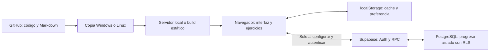

# Arquitectura y contratos de Vokal

Actualizado contra el código de la versión 0.3.0. La base funcional previa está en `8002135`.
Si se modifica un contrato descrito aquí, actualizar este documento en la misma entrega.

## 1. Enfoque general

### Actualización de autenticación — 2026-10-27

La interfaz usa GitHub. Los métodos OTP del cliente se conservan por compatibilidad, sin formulario activo.
`githubUrl(redirectTo)` genera un verificador aleatorio de32 bytes (64 caracteres hex), desafío SHA256/base64url
y URL `/auth/v1/authorize?provider=github` con `code_challenge_method=s256`. Admite HTTPS y HTTP solo en localhost/127.0.0.1.
La redirección conserva pathname, incluidos subdirectorios Pages, y elimina query/hash.
`completeOAuth(callbackUrl)` exige una solicitud local vigente (10 minutos) y envía auth_code/code_verifier
a `/auth/v1/token?grant_type=pkce`. Se elimina el verificador al completar o cancelar.
El almacenamiento temporal es sessionStorage, clave `vokal.auth:<proyecto>:pkce`; una nueva solicitud reemplaza la anterior.
app.js limpia el código de la URL con replaceState antes de cualquier intercambio y vuelve a #cuenta.
Carga caché por UUID y sincroniza; importar invitado sigue siendo explícito. Fallos se muestran sin borrar progreso.
Persistencia de sesión limitada a access_token/refresh_token/expires_at e id/email; no guarda tokens del proveedor.
Una revisión de sesión invalida renovaciones pendientes al cerrar sesión para impedir que restauren la cuenta.
Los contratos REST se contrastaron con el [OpenAPI oficial](https://github.com/supabase/auth/blob/master/openapi.yaml).
Pruebas simuladas confirman contratos; no sustituyen autorización ni comprobaciones RLS reales.

Vokal es una aplicación web estática de una sola página, escrita con HTML, CSS y módulos JavaScript nativos.
Node se usa para desarrollo, pruebas y construcción de archivos públicos; no hay servidor de aplicación propio en producción.
No hay React, framework de rutas, bundler, SDK de Supabase, base de datos local ni dependencias del registro npm.
pnpm organiza los comandos y establece controles para futuras dependencias.

El navegador recibe contenido de aprendizaje versionado en el repositorio.
El progreso se conserva en localStorage y, cuando se configure, se combinará con el estado de Supabase.
La interfaz funciona sin configuración de nube: muestra explícitamente que el progreso es local.



Git transporta desarrollo y contexto. Supabase transportará progreso de alumnos. Son canales distintos.

## 2. Inventario de archivos

### Aplicación

| Archivo | Responsabilidad | Dependencias o efectos relevantes |
| --- | --- | --- |
| `index.html` | Estructura, navegación, contenedor principal, apariencia y avisos | Carga CSS y módulos; incluye CSP en meta para alojamiento estático |
| `src/style.css` | Distribución, tarjetas, tipografía, estados y adaptación por ancho | Reescrito para eliminar reglas/colores antiguos y dar coherencia al rediseño |
| `src/theme.css` | Tokens negro con rosa/amarillo suave y claro neutro, contraste y esquemas | Paleta separada de la estructura; aliases green/lime solo por compatibilidad |
| `src/theme.js` | Preferencia del sistema y botón sol/luna (sistema inicial, elección persistente) | Lee/escribe `vokal.theme`; conserva valores anteriores y actualiza data-theme/meta |
| `src/app.js` | Rutas, renderizado, eventos, ejercicios y coordinación de persistencia/sincronización | Consume contenido, lógica pura, configuración y cliente de nube |
| `src/content.js` | Tres lecciones originales y composición del catálogo completo | Conserva IDs antiguos; incorpora currículo y elimina IDs repetidos del catálogo |
| `src/curriculum.js` | Orden de secciones, ampliación de lecciones, teoría, diálogos y preguntas específicas | Genera objetos de lección a partir de datos redactados para el proyecto |
| `src/vocabulary-data.js` | 5000 lemas de diccionario con traducciones, sentidos, POS/género y frecuencia | Archivo generado, con procedencia y licencia en VOCABULARY_SOURCES |
| `src/vocabulary.js` | Crea 25 secciones y 200 bloques a partir de los datos | Ruta LEX independiente, revisión pendiente y reutilización de IDs compatibles |
| `src/learning.js` | Normalización, corrección, repasos, validación, combinación y desbloqueo | Lógica independiente del DOM y probada con Node |
| `src/cloud.js` | Validación de configuración y API REST de autenticación/sincronización | Usa fetch, HTTPS, localStorage y timeout; no instala un SDK |
| `src/config.js` | URL y clave publishable del proyecto Vokal, versionadas | Son identificadores públicos del frontend; no hay credenciales administrativas |
| `src/config.local.js` | Configuración pública específica de una instalación, opcional | Ignorado por Git; el servidor/build lo procesa sin exponer el archivo directamente |

### Herramientas

| Archivo | Responsabilidad |
| --- | --- |
| `package.json` | Nombre/versión, Node mínimo, pnpm fijado y scripts |
| `pnpm-lock.yaml` | Resolución versionada; actualmente no contiene paquetes externos |
| `pnpm-workspace.yaml` | Espera de versiones, permisos de build de dependencias y controles de instalación |
| `scripts/check.mjs` | Recorre los JS/MJS de src y scripts y valida su sintaxis con Node |
| `scripts/serve.mjs` | Servidor local con lista permitida de archivos, tipos MIME y cabeceras |
| `scripts/public-files.mjs` | Lista única de archivos públicos usada por servidor y build |
| `scripts/config.mjs` | Selecciona configuración pública, la valida y genera el módulo servido/compilado |
| `scripts/build.mjs` | Copia archivos permitidos a dist y escribe la configuración pública generada |
| `scripts/browser-check.mjs` | QA en Chromium/Edge vía DevTools Protocol y WebSocket nativo |
| `scripts/import-vocabulary.py` | Importación reproducible con Python estándar, fuentes fijadas y hashes; sin extraer rutas del tar al disco |
| `.githooks/pre-commit` | Ejecuta pnpm check antes del commit |
| `.githooks/pre-push` | Ejecuta pnpm check antes del push |
| `.github/workflows/check.yml` | Sintaxis, pruebas, auditoría y build en Windows/Linux |
| `.github/workflows/pages.yml` | Publicación estática manual a GitHub Pages |
| `.gitattributes` | Saltos LF consistentes, incluidos hooks, para Windows/Linux |
| `.gitignore` | Excluye dependencias, dist, configuración local, archivos de entorno y evidencia QA |

### Pruebas y base de datos

| Archivo | Cobertura o propósito |
| --- | --- |
| `tests/learning.test.mjs` | Corrección, caracteres alemanes, intervalos, contenido, migración, desbloqueo y combinación |
| `tests/cloud.test.mjs` | Configuración, OTP, cabeceras, sesión, renovación compartida, errores y cierre con API simulada |
| `tests/server.test.mjs` | Recursos públicos, CSP, ocultación de archivos privados y rutas malformadas |
| `tests/theme.test.mjs` | Botón sol/luna, sistema/persistencia/almacenamiento bloqueado y contraste de ambas paletas |
| `tests/vocabulary.test.mjs` | 5000 lemas, cobertura de práctica, tamaños, desbloqueo independiente y restauración a escala |
| `supabase/migrations/001_progress.sql` | Tabla, RLS, funciones de combinación y RPC autenticada |

Los archivos de contexto se describen en [el índice](README.md). No se sirven como recursos de la aplicación.

## 3. Navegación y renderizado

Las rutas usan el fragmento de la URL. No requieren redirecciones de servidor y funcionan bajo un subdirectorio como `/Vokal/`.

| Fragmento | Vista |
| --- | --- |
| `#inicio` o fragmento vacío | Resumen, siguiente lección, estadísticas y sección actual |
| `#ruta` | Todas las secciones, orden y bloqueos |
| `#ruta/A1`, `A2`, `B1`, `B2`, `C1` | Filtro de ruta por nivel |
| `#ruta/LEX` | Resumen de 25 secciones de vocabulario, con atribución y revisión pendiente |
| `#seccion/lexico-NN` | Ocho bloques de 25 palabras y evaluación de esa sección |
| `#leccion/ID` | Teoría, gramática, contexto, diálogo, vocabulario y práctica |
| `#practica/ID` | Ejercicios de una lección iniciados desde su vista |
| `#evaluacion/ID-DE-SECCION` | Evaluación de una sección iniciada desde la interfaz |
| `#palabras` | Catálogo con búsqueda, filtro por nivel y páginas de 24 entradas |
| `#repaso` | Entradas vencidas o tarjetas de un repaso activo |
| `#cuenta` | Estado de nube, autenticación y acciones de sesión |

`render()` reemplaza el contenido principal y actualiza `aria-current` en la navegación.
El primer render no fuerza foco/desplazamiento; las navegaciones posteriores conservan el foco del contenido.
La delegación de eventos está en el contenedor main para conservar controladores al cambiar el HTML.
Las búsquedas actualizan solo resultados y paginación; las respuestas enfocan el botón Continuar.
Cambiar de ruta descarta la sesión de ejercicios si ya no corresponde a su ruta.

Una URL de práctica abierta directamente no restaura preguntas: muestra cómo regresar a una lección.
Abrir por URL una lección bloqueada muestra su restricción. El bloqueo es pedagógico del cliente, no un control de acceso a contenido secreto.

## 4. Contrato del contenido

### Sección

Cada elemento de `units` tiene `id`, `level`, `title` y `description`, más `track` opcional.
Sin track se considera course. Las unidades importadas usan track=vocabulary y level=LEX, sin equivalencia MCER.
El orden define prerrequisitos dentro de cada track: cada sección exige todas las lecciones anteriores de su ruta.
Las primeras secciones de curso y vocabulario están abiertas independientemente. No hay un grafo de dependencias general.

### Lección

Cada lección contiene:

- `id`: identificador estable del progreso.
- `unit`, `level`, `category`: pertenencia y clasificación.
- `title`, `subtitle`, `theory`, `grammar`, `tip`: material explicativo y contexto.
- `dialogue`: pares `[alemán, español]`.
- `example`: par heredado/representativo del diálogo.
- `words`: filas `[id, alemán, español, ejemplo]`.
- `questions`: preguntas específicas de concepto o gramática.

Las tres lecciones originales conservan sus IDs y los de sus entradas para que el progreso previo siga siendo reconocido.
Las nuevas lecciones usan `make()` para construir objetos coherentes y generan IDs de términos con prefijo `term-`.
No renombrar IDs publicados sin una migración explícita: `readState` descarta IDs que no reconoce.

`content.js` exporta `lessons`, `units` y un catálogo `words` deduplicado por ID mediante Map.
Cada entrada del catálogo añade `lesson` y `level` de su primera aparición. Las tarjetas de una lección usan sus propias filas.
Si se reutiliza una entrada en varios niveles, el filtro global actual la clasifica por su primera aparición.
La importación añade metadatos de fuente a 5000 registros, conservando ejemplos/IDs compatibles del curso (188 reutilizados).
El filtro LEX usa procedencia para mostrar los 5000 términos, aunque uno también aparezca en A1–C1.
Los campos nuevos son lemma, pos, gender, source, reviewStatus, translations, definitions y frequencyRank.
Los IDs nuevos de palabra usan lex- más el lema en minúsculas; las lecciones usan lexico-NN-NN.
No cambiar el canon de IDs sin migrar progreso. Las filas de palabras mantienen cuatro elementos y ejemplo puede ser vacío.

### Pregunta

Una pregunta tiene `prompt`, `answers` (lista de respuestas aceptadas), `explanation` y opcionalmente `options` y `wordId`.
La presencia de `options` determina si se muestra selección o escritura.
`wordId` conecta el resultado con el repaso de esa entrada.

`lessonQuestions()` concatena:

1. Preguntas específicas de la lección.
2. Una pregunta de reconocimiento por entrada, con distractores de la misma lección.
3. Una pregunta de escritura por entrada, pidiendo el término aprendido con su artículo si corresponde.

La posición correcta se rota de forma determinista. No hay aleatoriedad ni un modelo de IA generando preguntas en tiempo real.
`assessmentQuestions()` toma preguntas específicas más las tres primeras de reconocimiento y las tres últimas de escritura.
Una evaluación cubre una muestra; no demuestra todo el vocabulario del nivel.

## 5. Corrección, dominio y repasos

### Corrección

`normalize()` recorta extremos, normaliza Unicode NFC, pasa a minúsculas alemanas,
elimina puntuación final `. ! ?` y unifica espacios. `isCorrect()` compara con cada respuesta declarada.

Consecuencias conocidas:

- Se acepta variación de mayúsculas; la interfaz sí enseña la forma escrita.
- No se equiparan `ö/o` ni `ß/ss`.
- Una traducción sinónima no declarada puede rechazarse.
- No hay evaluación semántica de producción libre.

### Dominio

Cada respuesta cuenta una sola vez. Se registra si se acertó al primer intento.
Al terminar, `score / total >= 0.8` marca la lección como completada.
Una evaluación aprobada marca las lecciones de esa sección; una reprobada permite repetir sin castigo.
Los logros previos no se eliminan por una repetición peor.

La primera sección de cada ruta está abierta. Las siguientes exigen todas las lecciones previas de su propia ruta.
La evaluación solo se inicia para una sección disponible; puede saltar su práctica, no omitir todos los prerrequisitos de golpe.

### Repaso

Por entrada se acumula evidencia durante la práctica. Si una de sus respuestas falla, la evidencia de esa entrada queda en falso.
Al finalizar la práctica se ajustan solo las entradas que participaron en ejercicios vinculados a `wordId`.
Las preguntas gramaticales sin wordId cuentan para el resultado, pero no crean una entrada de repaso.

`schedule()` devuelve `streak`, `due` y `updatedAt`:

| Resultado | Próximo intervalo |
| --- | --- |
| Error | 10 minutos; racha 0 |
| Primer acierto de la racha | 1 día |
| Segundo | 3 días |
| Tercero | 7 días |
| Cuarto | 14 días |
| Quinto | 30 días |
| Sexto y posteriores | 60 días, racha limitada a 6 |

`dueWords()` solo devuelve entradas ya practicadas cuyo `due <= ahora`.
En las tarjetas, el alumno revela el significado y se autoevalúa. Esta autoevaluación no es reconocimiento automático del habla.

## 6. Estado y persistencia

### Objeto de progreso

```json
{
  "completed": ["saludos"],
  "reviews": {
    "hallo": {"streak": 1, "due": 100000000, "updatedAt": 13600000}
  },
  "assessment": null,
  "results": {
    "saludos": {"score": 25, "total": 27, "updatedAt": 13600000}
  },
  "assessments": {
    "a 1-primeros": {"score": 24, "total": 27, "updatedAt": 13600000}
  }
}
```

Los números anteriores son ilustrativos, no progreso real de un alumno. Fechas del cliente: milisegundos desde Unix epoch.
`assessment` se conserva por compatibilidad con la evaluación global antigua; las evaluaciones actuales usan `assessments` por sección.

`readState()` valida el JSON, restringe IDs a los conocidos y elimina rachas, fechas o puntuaciones inválidas.
Una revisión antigua sin `updatedAt` recibe 0. No modifica la fecha `due` de un registro válido antiguo.

### Claves de navegador

| Clave | Contenido |
| --- | --- |
| `vokal.progress.v1` | Progreso de invitado, conservado para compatibilidad |
| `vokal.progress.v2:UUID` | Copia de progreso separada para un usuario autenticado |
| `vokal.auth:https://PROYECTO.supabase.co` | Sesión de autenticación del proyecto |
| `vokal.theme` | `system`, `dark` o `light` |

No inspeccionar/copiar valores reales de sesión a logs o documentación.
Se guarda progreso al terminar la práctica/evaluación o autoevaluar una tarjeta de repaso.
Una práctica incompleta no se serializa y no se reanuda después de recargar.
La preferencia visual permanece por dispositivo; no forma parte del objeto sincronizado.

Al iniciar sesión se carga la copia asociada a esa cuenta, sin incorporar automáticamente el invitado.
La importación de invitado requiere pulsar un botón explícito. Cerrar sesión vuelve a la copia de invitado.

## 7. Configuración pública

Orden de selección por campo en `scripts/config.mjs`:

1. Variable `SUPABASE_URL` o `SUPABASE_PUBLISHABLE_KEY`, si contiene un valor no vacío tras recortar espacios.
2. `src/config.local.js`, si existe.
3. Identificadores públicos de Vokal en `src/config.js`.

Las variables vacías o compuestas solo de espacios no sobrescriben la configuración local/predeterminada.
Esto evita desconectar Pages cuando sus variables opcionales todavía no existen.
Para usar solo modo local, se puede crear config.local.js con ambos campos vacíos.
El módulo local no es un .env y no se carga un .env automáticamente.

`validateConfig()` permite desactivar ambos valores vacíos. Si hay configuración exige HTTPS con dominio de proyecto `*.supabase.co`
y una clave publishable o JWT con rol anon. No soporta actualmente un dominio personalizado de Supabase.
La validación del JWT identifica su rol declarado; la validez criptográfica y los permisos se comprueban en Supabase.

## 8. Cliente de nube

El cliente usa fetch, cabecera `apikey` y, en operaciones privadas, `Authorization: Bearer ACCESS_TOKEN`.
El timeout es de 15 segundos. Se muestran errores de red, de autenticación, de límite 429 y errores generales; no se ocultan como éxito.

| Método | Endpoint | Comportamiento |
| --- | --- | --- |
| `sendCode(email)` | POST `/auth/v1/otp` | Solicita OTP con creación de usuario permitida |
| `verifyCode(email, code)` | POST `/auth/v1/verify` | Verifica tipo email y guarda la sesión devuelta |
| Renovación interna | POST `/auth/v1/token?grant_type=refresh_token` | Renueva si quedan 60 segundos o menos |
| `sync(progress)` | POST `/rest/v1/rpc/sync_progress` | Envía `{ incoming: progreso }` y recibe progreso combinado |
| `signOut()` | POST `/auth/v1/logout?scope=local` | Intenta revocar la sesión actual y borra la sesión local en memoria/almacenamiento |

Una promesa compartida evita renovar dos veces simultáneamente dentro de la misma instancia del cliente.
No hay un coordinador de renovación entre varias pestañas; no declarar ese caso como comprobado.

`app.js` guarda primero la copia local y programa una sincronización con demora de 700 ms.
También sincroniza al recuperar conexión o foco, al iniciar una sesión restaurada y por botón manual.
Evita trabajos simultáneos y repite cuando se solicita otro durante uno activo.
Si cambia la cuenta, descarta resultados pendientes del propietario anterior y solicita sincronización de la cuenta nueva.

La respuesta se valida y combina con el estado actual para conservar cambios locales ocurridos durante la solicitud.
En error se conserva la copia local y se indica pendiente; la siguiente sincronización ocurre por interacción, foco, conexión o acción manual.
No hay reintento ilimitado en segundo plano ni garantía de que la última escritura llegue si se cierra la pestaña de inmediato.

## 9. PostgreSQL y RLS

`learning_progress` contiene:

- `user_id uuid`: clave primaria y referencia a `auth.users`, borrado en cascada si se borra el usuario.
- `state jsonb`: objeto completo de progreso.
- `updated_at timestamptz`: fecha del servidor de la actualización.

RLS está habilitado. Las políticas select/insert/update exigen que `auth.uid()` coincida con user_id.
Anon no recibe permisos de tabla y no puede ejecutar la RPC. No existe una política de borrado desde la aplicación.

Funciones:

- `merge_progress_map(a,b)`: combina mapas por ID y elige la mayor marca `updatedAt`; en empate prefiere la entrada existente.
- `merge_learning_progress(a,b)`: une `completed` sin duplicados y combina reviews, results y assessments.
- `sync_progress(incoming)`: exige sesión, tipos de campos y tamaño máximo de 4 000 000 bytes para el JSON entrante;
  inserta o actualiza con `ON CONFLICT` y devuelve el estado combinado dentro de la operación del servidor.

La función es `security invoker`, con search_path vacío y referencias de esquema explícitas.
La separación de usuarios depende de RLS, no de confiar en un UUID que mande el navegador.
El cliente no necesita una clave administrativa.

Los logros se unen: no existe reseteo/borrado sincronizado. Los mapas resuelven conflictos por reloj del dispositivo;
la hora del servidor de la fila no sustituye la marca individual. Desajustes grandes de reloj y nuevos esquemas requieren pruebas adicionales.
La migración se debe ejecutar una vez; no es completamente idempotente porque las políticas se crean sin cláusula de reemplazo.
El propietario informó ejecución SQL sin errores. Se comprobó la API real: tabla y RPC rechazan solicitudes sin sesión
con HTTP 401/código 42501. No se inspeccionaron las políticas ni se ejecutaron pruebas autenticadas de aislamiento/concurrencia.

## 10. Build, servidor y alojamiento

El servidor escucha únicamente `127.0.0.1: 3000`; acceder desde otro dispositivo no equivale a escribir localhost en ese dispositivo.
El servidor de desarrollo no se publica como servicio de producción ni se abre a la red por defecto.
La lista `publicFiles` permite once archivos de aplicación; config.js se genera aparte: doce archivos públicos.
El servidor responde 404 a contexto, SQL, .git, configuración local y archivos de entorno.

El build crea `dist/`, copia esos archivos (incluido el catálogo de aproximadamente 1.3 MB sin comprimir) y genera `dist/src/config.js` con valores públicos validados.
No ejecuta un bundler ni instala paquetes. Tampoco borra automáticamente archivos antiguos de dist.
En CI el checkout empieza limpio; antes de publicar un dist local reutilizado, comprobar que no contiene archivos extra.
No publicar la raíz del repositorio como directorio estático.

El workflow de comprobaciones corre en push/PR y valida Windows/Linux.
El de Pages solo se ejecuta por workflow_dispatch y necesita habilitar Pages en el repositorio.
Sus variables de build son las URL/clave públicas; no deben ser una service_role ni una contraseña.
El resultado de un build no equivale a un despliegue y un despliegue no equivale a nube funcionando.

## 11. Límites y siguientes cambios

Conservar la simplicidad no permite marcar como terminados curso, nube, pronunciación o validación lingüística.
Para escalar el catálogo habrá que revisar importación/licencias, metadatos, respuestas alternativas, descarga por módulos
y búsqueda, en lugar de añadir miles de términos sin control. La implementación actual carga todo el currículo disponible en memoria.
Consultar [CONTENT](CONTENT.md), [ROADMAP](ROADMAP.md) y [CLOUD](CLOUD.md) antes de ampliar esas áreas.

## Apariencia — revisión 2026-10-26

Tarjetas y controles de esquinas suavizadas; sin gradiente, sombras ni ilustración decorativa del inicio.
Paleta negro con rosa/amarillo suave y claro piedra. `#theme-toggle` es un botón nativo con SVG de sol/luna:
el icono y su nombre accesible indican el modo que activará. Sin selector adicional.
Se conserva `vokal.theme`: `system` o ausencia siguen al sistema hasta la primera pulsación;
`light`/`dark` antiguos se respetan. Cada pulsación guarda el modo opuesto al efectivo.
La interfaz ya no ofrece volver al modo automático; eliminar esa clave permite restablecerlo.
Se mantienen conteos útiles de progreso/búsqueda y avisos de procedencia, sin titulares publicitarios de volumen.

### Segunda revisión visual del 2026-10-26

La preferencia vigente sustituye verde pino: negro neutro, rojo rosado y amarillo pastel, claro piedra sin blanco puro.
Cada bloque de theme.css define todos los tokens hero y botones; no heredar un hero oscuro fijo al cambiar a claro.
Tarjetas sin borde (separadas por superficie/espacio), radio 12 px. Campos y foco conservan contornos de interacción.
El amarillo aparece en el botón principal oscuro y en la cifra de práctica; rojo rosado en navegación/acentos.
La prueba de contraste incluye hero-ink/hero, hero-text/hero y gold/surface; otra exige tokens hero en cada modo.

## Capa editorial y notas de ejercicios — 2026-10-26

src/vocabulary-corrections.js almacena ajustes por lema exacto del piloto, separados de datos importados.
vocabulary.js aplica traducciones/definiciones/POS opcionales y editorialNote antes de crear entradas y lecciones.
Categoría particle añadida para nicht. reviewStatus permanece pending; no es un sello de revisión humana.
Tupla opcional ampliada:[id,de,es,example,note]; learning.js añade note a explicaciones, nunca a respuestas válidas.
content.js conserva IDs/metadatos y prioriza el significado ajustado frente al texto heredado en el catálogo.
app.js muestra editorialNote escapada en cada ficha. Originales guiados conservan sus propios sentidos.
Lista pública añade vocabulary-corrections.js; build de 13 recursos. Header 64 px/padding de 8 px y main superior 28 px.

## Correcciones de forma, género y ejemplo — lote 201–500

La capa editorial admite de/gender/example opcionales. vocabulary.js los aplica antes de generar bloques;
content.js prioriza de/example derivados en el catálogo sobre el registro heredado, conservando ID/level/progreso.
Si el sentido elegido cambia el artículo, deben coincidir de, gender y la pregunta generada del sustantivo;
no basta con cambiar el texto español. Alter se acota a das Alter/edad/neutro; Teil a das Teil/pieza.
Para ambos se retira el ejemplo heredado de otro sentido/género con example vacío, sin fabricar una frase.
Las lecciones guiadas originales conservan sus propios materiales; este lote no certifica sus paradigmas.
La capa acumula171 ajustes/notas. Raw y sus hashes no cambian. reviewStatus sigue pending.
Nuevo tests/review-ledger.test.mjs: 300 índices y lemas coincidentes con el raw, estado/alcance/fuente explícitos.
Es control documental, no un verificador de verdad lingüística. La fuente fallida se conserva como duda, nunca como prueba positiva.

Se evita mezclar sentidos: wordCard muestra nota/definición editorial solo cuando de/es coinciden con la ficha corregida; las lecciones guiadas de otro sentido conservan su texto sin esa nota. Regresión de render probada con la función real y VM de Node, sin nuevo navegador.

## Estado editorial por sentido

La capa vocabulary-corrections.js puede incluir review:{date,humanReviewed:false,sources:[{name,url},…]}.
vocabulary.js deriva sense-checked-ai si hay review curada; en otro caso pending. content.js preserva review explícitamente.
La validación de esquema/conjunto/fuentes en pruebas evita aprobar registros por una marca vacía o un cambio masivo.
WordCard requiere coincidencia de/es con el sentido del catálogo para mostrar distintivo y fuentes; otro sentido sigue pendiente.
Se indica IA sin revisión humana. La evidencia cubre significado/categoría/artículo, no ejemplos o paradigmas completos.
Los22 registros con este estado no tienen ejemplos incluidos; los 4978 restantes siguen pending. Lesson.reviewStatus permanece pending.
No confundir review editorial pública con state.reviews privado (repaso espaciado). No cambia contrato de nube/progreso.
Capa 193 registros, build de 13 recursos. Detalle y fuentes en reviews/RECHECK-22 y política en REVIEW_POLICY.

## Lote editorial 501–1000 — 2026-10-27

La implementación más reciente añade src/vocabulary-review-501-1000.js: 500 filas curadas y un objeto por lema.
Cada fila conserva índice del raw, lema, forma de estudio, traducción, categoría/género, alcance, URLs y estado.
Se mezcla al final de vocabularyCorrections. No se modifica raw ni el algoritmo de IDs; los cambios de progreso siguen siendo compatibles.
497 filas incluyen review (fecha, dos fuentes de familias distintas, humanReviewed=false); tres no incluyen review y siguen pending.
Definitions y example se vacían deliberadamente para no asociar material de otras acepciones al sentido contrastado.
POS admite part/num/conj/prep. La forma editorial puede incluir sich o una construcción, conservando el ID del lema.
La pregunta de artículo solo toma sustantivos cuya forma empieza por der/die/das; no inventa artículos de nombres propios.
El módulo debe estar en publicFiles para servir/desplegar; build de14 recursos. Sin dependencias nuevas.
Los tests de22 registros se conservan como regresión de un subconjunto; tests/vocabulary-501-1000.test.mjs valida el nuevo lote completo.
Conteos de esta rama:519 sentidos contrastados,4481 pendientes,693 registros editoriales. Al integrar OpenCode actualizar STATUS.
No cambia el contrato word.review frente a state.reviews ni el estado pendiente de las lecciones con contenido mixto.

## Curación efectiva y meta1000 — actualización posterior

vocabulary-review-001-500.js añade478 ajustes previos pendientes y5 complementos1001–1005; sus22 filas históricas no se aplican otra vez.
vocabulary-review-501-1000.js aporta500 ajustes. Ambos objetos se mezclan al final de vocabularyCorrections.
Por tanto, editar una clave antigua de la base puede no cambiar el resultado: modificar el módulo del rango correspondiente.
POS añade pron=Pronombre para cuantificadores y mantiene part/num/conj/prep. Las construcciones se almacenan en de sin cambiar ID.
Estado verificado de esta entrega:1000 contrastadas/4000 pendientes/1005 registros editoriales; build15 y37 pruebas.
No cambian contratos de nube o progreso. Las cifras de párrafos anteriores describen entregas históricas.
